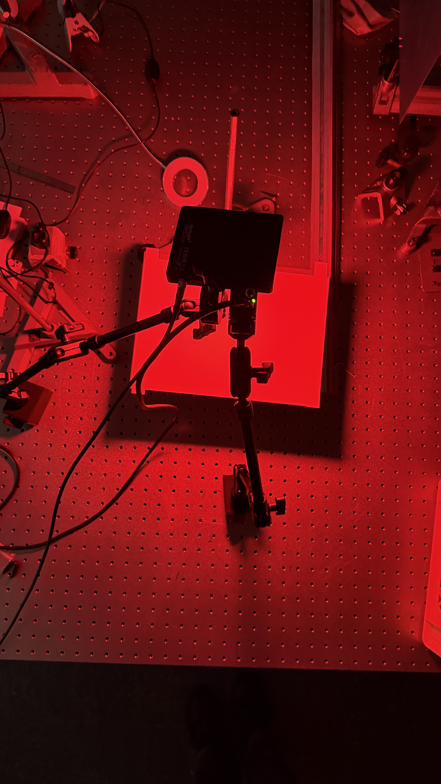
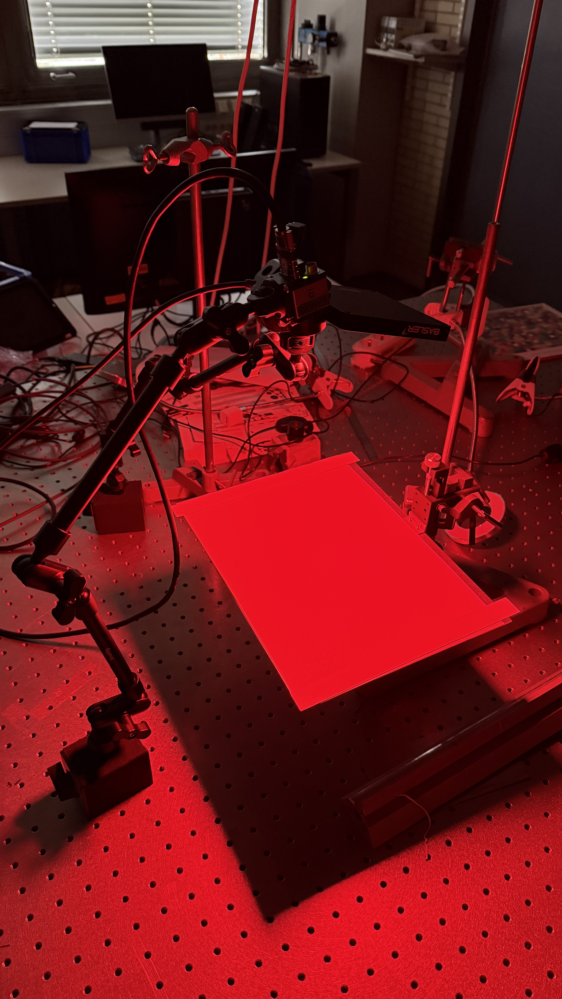

# Sensorcharakterisierung

Pfad: `\\Laboraufgaben\1_franz_char_radiom.pdf`
Rechnungen `\\rechnung.py`

---

## Versuchsaufbau
 

 

---

## Messdaten
 * Wellenlänge  = 640 [nm] (Annahme!)
 * Sensordiagonale = 19,3 [mm]
 * Pixelanzahl = $24,47 * 10^6$
 * Pixelfläche = 14,599 x 12,626 [$mm^2$] * $10^-6$ =  
 * Sensorentfernung zu Papier &asymp; 25 [cm] (Annahme!)  
 * Bestrahlungsstärke E [$\frac{W}{m^2}$] = 0,33 [$\frac{W}{m^2}$]
 * Pixelfläche A =0,000184326974 [$m^2$] &asymp; 0,000184 [$m^2$]
  
## Aufgaben

### 1.2
* Belichtungszeit = 15 [ms] / 1000 = $15 * 10^{-3}$ [s] 

$\mu_p = 5.034 \cdot 10^{24} A \cdot E \cdot t_{exp} = 8,907859076313599 * 10^{22} \approx 8,908 *10^{22}$

### 1.3 

gewählte Belichtungszeiten:
* 0.1 ms
* 9 ms
* 17 ms
* 25 ms
* 34 ms
* 42 ms
* 50 ms
* 55 ms
* 60 ms
* 65 ms
* 70 ms
* 100 ms

